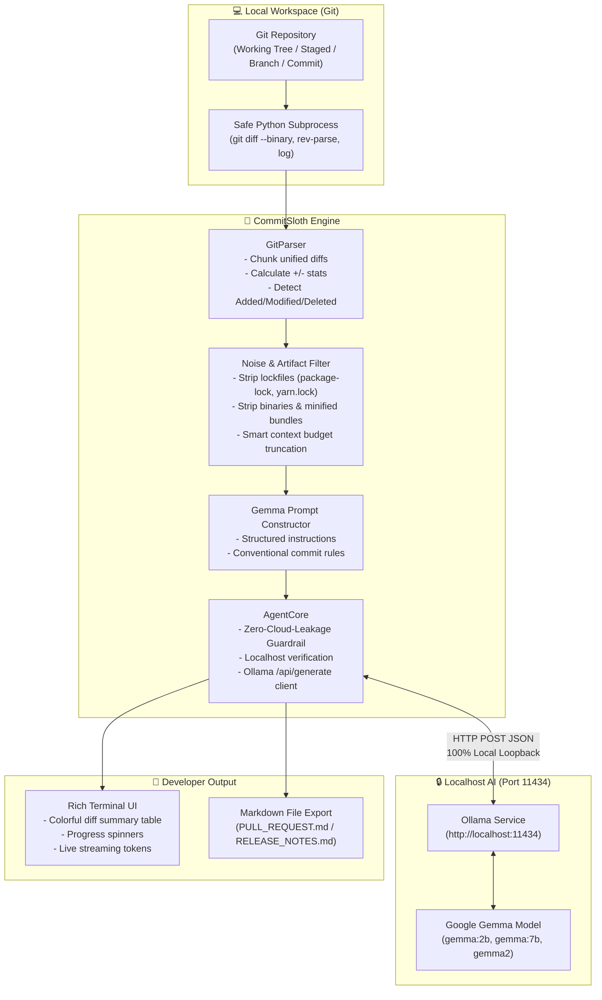

# CommitSloth 🦥

> **"Slow and Steady" developer paperwork using local, open-weight AI.**  
> *Built for the Hacktoberfest 2026 Open-Source AI Challenge.*

[](https://opensource.org/licenses/MIT)
[](https://www.python.org/downloads/)
[](https://ai.google.dev/gemma)
[](https://ollama.com)
[](#️-zero-cloud-leakage-guarantee)

---

## 🌟 Why CommitSloth?

Developers love writing code, but writing Pull Request descriptions, changelogs, and release paperwork is tedious and easy to rush. During Hacktoberfest's **"Slow and Steady"** week, CommitSloth encourages developers to take a breath, slow down, and let a thoughtful local AI assistant craft professional documentation—**without sending proprietary code to the cloud.**

**CommitSloth** runs entirely on your machine. It analyzes your local git repository, filters out irrelevant build noise and lockfiles, and prompts Google's open-weight **Gemma** model via **Ollama** (`http://localhost:11434`) to produce:

- 🎯 **Conventional Commits PR Title** (e.g. `feat(auth): implement offline token verification`)
- 📋 **Bulleted Technical Changelog** categorizing functional code changes
- 🧪 **Reviewer Testing Instructions** with actionable verification steps
- 🚀 **Release Notes Summary** for version tags and changelog logs

---

## 📐 Architecture



---

## 🛡️ Zero Cloud Leakage Guarantee

- **100% Offline-First:** CommitSloth only connects to loopback addresses (`localhost`, `127.0.0.1`, `::1`).
- **No Third-Party APIs:** No OpenAI, Anthropic, or external cloud keys required.
- **Strict Host Verification:** `AgentCore` inspects endpoints before transmitting code diffs and throws a `SecurityViolationError` if any non-loopback URL is detected.

---

## 🚀 Quickstart

### 1. Prerequisites

- **Python 3.10+**
- **Git** installed and available in your `PATH`
- **[Ollama](https://ollama.com)** installed and running on `localhost:11434`

### 2. Download Google Gemma via Ollama

Open your terminal and pull Google's lightweight open-weight Gemma model:

```bash
# Ultra-fast 2B parameter model (recommended for quick local diffs):
ollama pull gemma:2b

# Or the comprehensive 7B parameter model:
ollama pull gemma:7b
```

Ensure the Ollama daemon is active:

```bash
ollama serve
```

### 3. Clone and Setup CommitSloth

```bash
# Clone the repository
git clone https://github.com/CommitSloth/CommitSloth.git
cd CommitSloth

# Create an isolated virtual environment
python -m venv .venv

# Activate the virtual environment
# Windows (PowerShell):
.venv\Scripts\Activate.ps1
# macOS / Linux:
source .venv/bin/activate

# Install dependencies
pip install -r requirements.txt
```

---

## 💻 Usage

Run CommitSloth directly from your terminal:

### Basic: Analyze uncommitted changes in current repository

```bash
python commitsloth.py
```

### Analyze only staged git changes (`git diff --cached`)

```bash
python commitsloth.py --staged
```

### Compare current feature branch against base branch (`main`)

```bash
python commitsloth.py --branch main
```

### Analyze a specific commit

```bash
python commitsloth.py --commit HEAD~1
```

### Save PR documentation to a Markdown file

```bash
python commitsloth.py -o PULL_REQUEST.md
```

### Stream Gemma's output live in your terminal

```bash
python commitsloth.py --stream
```

### Inspect diff statistics without calling Ollama (`--diff-only`)

```bash
python commitsloth.py --diff-only
```

### Test mode with synthetic response (`--mock`)

Useful for testing in CI environments or before downloading model weights:

```bash
python commitsloth.py --mock -o PR.md
```

---

## ⚙️ Command-Line Options

| Flag | Argument | Description | Default |
| :--- | :--- | :--- | :--- |
| `-r`, `--repo` | `PATH` | Path to target git repository | `.` (Current dir) |
| `-s`, `--staged` | - | Analyze only staged changes | `False` |
| `-b`, `--branch` | `NAME` | Compare current branch with base branch | `None` |
| `-c`, `--commit` | `HASH` | Analyze specific commit ref | `None` |
| `-m`, `--model` | `NAME` | Ollama model tag | `gemma:2b` |
| `--host` | `URL` | Local Ollama endpoint | `http://localhost:11434` |
| `--timeout` | `SEC` | Max seconds to wait for model inference | `120` |
| `--stream` | - | Stream response tokens in real-time | `False` |
| `--mock` | - | Generate synthetic response without Ollama | `False` |
| `-o`, `--output` | `FILE` | Export output to Markdown file | `None` |
| `--diff-only` | - | View filtered diff table without AI | `False` |
| `-v`, `--version` | - | Show version information | - |
| `-h`, `--help` | - | Show help message and exit | - |

---

## 🧹 Intelligent Noise & Lockfile Filtering

Large diffs from package managers (e.g. `package-lock.json` with 2,000+ line diffs) easily blow past local LLM context windows and degrade summary quality.

CommitSloth automatically filters out noise:

- **Lockfiles:** `package-lock.json`, `yarn.lock`, `pnpm-lock.yaml`, `poetry.lock`, `Cargo.lock`, `Pipfile.lock`, `composer.lock`, `go.sum`, etc.
- **Binary Assets:** `*.png`, `*.jpg`, `*.svg`, `*.pdf`, `*.mp4`, `*.zip`, `*.bin`, `*.exe`
- **Minified Bundles:** `*.min.js`, `*.min.css`, `*.bundle.js`, `*.map`
- **Caches & Builds:** `node_modules/*`, `dist/*`, `build/*`, `__pycache__/*`, `.venv/*`

---

## 🧪 Running Tests

CommitSloth includes a unit test suite covering git subprocess execution, diff chunking, noise filtering, zero-cloud-leakage guardrails, and CLI arguments:

```bash
# Run pytest with verbose reporting
pytest tests/ -v
```

---

## 📄 Example Generated Output

````markdown
# feat(git): implement offline git diff parsing and local gemma integration

## 📋 Changelog & Key Changes
- **`commitsloth/git_parser.py`**: Added safe subprocess invocation with automatic lockfile and artifact filtering.
- **`commitsloth/agent_core.py`**: Implemented local Ollama loopback client with zero-cloud-leakage guardrails.
- **`commitsloth/cli.py`**: Created terminal interface with Rich styling and Markdown file export.

## 🧪 Testing Instructions
1. Run automated test suite:
   ```bash
   pytest tests/ -v
   ```
2. Verify diff extraction on local changes:
   ```bash
   python commitsloth.py --diff-only
   ```
3. Test local Ollama endpoint connection:
   ```bash
   python commitsloth.py --mock
   ```

## 🚀 Release Summary
CommitSloth provides a 100% offline developer productivity CLI that automates Pull Request and release notes generation using local Google Gemma models.
````

---

## 📜 License

CommitSloth is open-source software licensed under the [MIT License](LICENSE).
Built with ❤️ for the Hacktoberfest 2026 Open-Source AI Challenge.
